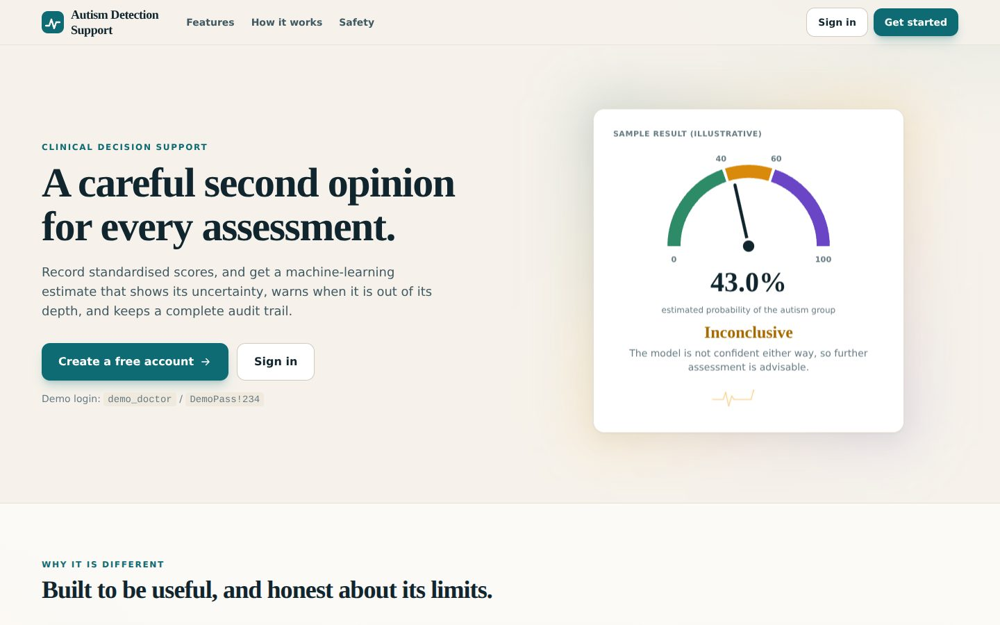
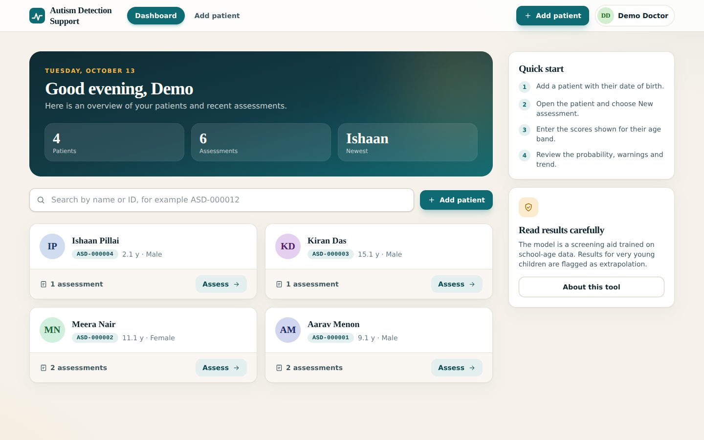
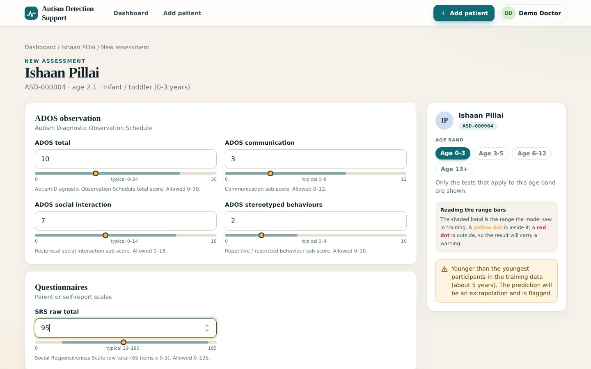
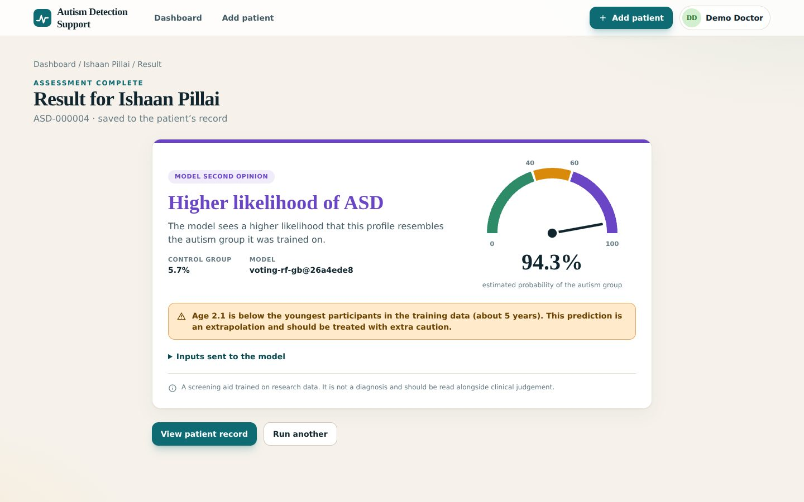

# Autism Detection App

A full-stack web app for autism spectrum disorder screening using clinical assessment scores.

## Project Structure

```
autism-detection/
├── frontend/               # React + Vite
│   ├── src/
│   │   ├── components/     # Reusable UI (Navbar)
│   │   ├── pages/          # Full page views (About, Register, History, etc.)
│   │   ├── services/       # API call functions
│   │   ├── styles/         # Per-component CSS files
│   │   ├── App.jsx         # Root component & page routing
│   │   └── main.jsx        # React entry point
│   ├── index.html
│   ├── vite.config.js
│   └── package.json
│
├── backend/                # Django REST Framework
│   ├── autismdetection/    # Project config (settings, urls, wsgi)
│   ├── patientreg/         # Patient registration & history app
│   ├── my_app/             # ML prediction app
│   │   └── models/         # .pkl files (scaler + voting classifier)
│   ├── manage.py
│   └── requirements.txt
│
├── .gitignore
└── README.md
```

## Prerequisites

- Python 3.10+
- Node.js 18+
- PostgreSQL

## Setup

### 1. Clone the repository

```bash
git clone <your-repo-url>
cd autism-detection
```

### 2. Backend Setup

```bash
cd backend

# Create and activate virtual environment
python -m venv venv
source venv/bin/activate       # Windows: venv\Scripts\activate

# Install dependencies
pip install -r requirements.txt

# Configure database (create a PostgreSQL DB named 'aut')
# Then set environment variables or edit backend/autismdetection/settings.py:
#   DB_NAME, DB_USER, DB_PASSWORD, DB_HOST, DB_PORT

# Run migrations
python manage.py migrate

# Start backend server
python manage.py runserver
```

Backend will run at **http://localhost:8000**

### 3. Frontend Setup

```bash
cd frontend

# Install dependencies
npm install

# Start development server
npm run dev
```

Frontend will run at **http://localhost:5173**

## Environment Variables (Backend)

| Variable              | Default             | Description              |
|-----------------------|---------------------|--------------------------|
| `DJANGO_SECRET_KEY`   | insecure default    | Django secret key        |
| `DJANGO_DEBUG`        | `True`              | Debug mode               |
| `DB_NAME`             | `aut`               | PostgreSQL database name |
| `DB_USER`             | `postgres`          | Database user            |
| `DB_PASSWORD`         | `1234`              | Database password        |
| `DB_HOST`             | `localhost`         | Database host            |
| `DB_PORT`             | `5432`              | Database port            |

## API Endpoints

| Method | URL                          | Description              |
|--------|------------------------------|--------------------------|
| POST   | `/api/register/`             | Register a patient       |
| POST   | `/api/verify-patient/`       | Verify patient by ID     |
| POST   | `/api/history/`              | Save pregnancy & milestones |
| POST   | `/model/predict-autism/`     | Run autism prediction    |

## Git

```bash
git init
git add .
git commit -m "Initial structured commit"
git remote add origin <your-github-url>
git push -u origin main
```

## Screenshots

### 1. Landing Page


### 2. Doctor Dashboard


### 3. Assessment Form


### 4. Assessment Result with Warning

